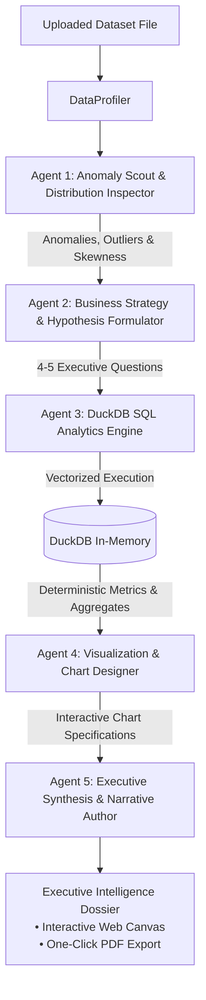

# DataViz AI — Autonomous Multi-Agent Executive Reporting System

## 1. Executive Overview & Vision

The **Autonomous Multi-Agent Executive Reporting System** transforms DataViz AI from a standard chat interface into an autonomous **Chief Data Officer & Senior Business Intelligence Team**. 

Instead of requiring users to manually ask 20 individual prompt questions and assemble findings into a slide deck or Word document, the platform operates autonomously:
1. The user uploads a data file (`.csv`, `.xlsx`, `.parquet`, `.json`).
2. An autonomous team of 5 specialized agents orchestrates data profiling, anomaly detection, strategic hypothesis generation, deterministic DuckDB calculation, and corporate narrative authoring.
3. The output is a publication-ready **Executive Intelligence Dossier** with embedded interactive charts, risk callouts, KPI scorecards, and one-click PDF export.

---

## 2. Why Pure Python (Zero-Framework Architecture)?

Rather than using heavy, brittle agent frameworks (e.g. CrewAI, LangChain, AutoGen), this system is built with **Pure Python (FastAPI + Asyncio + Pydantic + DuckDB)**.

* **Memory Efficiency**: Consumes only ~40 MB RAM (easily running within Render/Koyeb 512 MB free tier limits without OOM crashes).
* **Speed**: End-to-end multi-agent orchestration finishes in **4 to 8 seconds** (vs. 60–120s in recursive framework loops).
* **Deterministic Accuracy**: The LLM *reasons* and *hypothesizes*; DuckDB *calculates* the numbers with 100% mathematical accuracy.
* **Maintainability**: Clear, readable Python async functions with zero hidden prompt chains.

---

## 3. The 5 Specialized Agents



### Agent 1: Anomaly Scout & Distribution Inspector
* **Role**: Senior Data Quality & Statistical Auditor.
* **Input**: Column profile metadata, null rates, cardinality, numeric distributions (min, max, mean, std), and sample rows.
* **Responsibilities**:
  * Detect high null clusters and data anomalies.
  * Identify skewness, negative margins, and unusual spikes.
  * Formulate 3–4 statistical anomaly flags (e.g., *"Region West has 42% discount rate causing negative profitability"*).
* **Output**: `List[AnomalySignal]`

### Agent 2: Business Strategy & Hypothesis Formulator
* **Role**: Chief Strategy Officer (CSO) / Management Consultant.
* **Input**: Dataset domain context + Anomaly signals from Agent 1.
* **Responsibilities**:
  * Translates raw statistical anomalies into high-stakes executive questions.
  * Identifies the core business narrative (e.g., revenue concentration, customer churn risk, product cannibalization).
  * Generates 4 to 5 strategic analytical questions that a CEO, VP of Sales, or CFO would demand.
* **Output**: `List[StrategicHypothesis]`

### Agent 3: DuckDB SQL Analytics Engine
* **Role**: Lead Quantitative Analyst & SQL Architect.
* **Input**: Strategic hypotheses from Agent 2 + dataset schema.
* **Responsibilities**:
  * Compiles robust, high-performance DuckDB SQL queries for each hypothesis.
  * Executes the query vectorially directly against the file on disk.
  * Sanitizes queries against destructive commands; handles temporal rollups and grouping automatically.
* **Output**: `List[ExecutedFindingData]` (exact numbers, totals, and distributions).

### Agent 4: Visualization & Chart Designer
* **Role**: Principal BI & Information Designer.
* **Input**: Executed analytical results from Agent 3 + frontend chart registry capabilities.
* **Responsibilities**:
  * Selects the optimal visualization type for each finding (e.g., Line for temporal trajectories, Donut for market shares, Bar for comparative rankings, Treemap for hierarchical volume).
  * Configures axes, sorting, aggregation types, and coherent color palettes.
* **Output**: `List[VisualSpec]`

### Agent 5: Executive Synthesis & Narrative Author
* **Role**: Senior Executive Ghostwriter & Business Analyst.
* **Input**: All findings, verified data points, anomaly flags, and visual specs.
* **Responsibilities**:
  * Synthesizes a structured corporate briefing:
    1. **Executive Summary**: 3-sentence high-level takeaway.
    2. **Key Performance Indicators (KPIs)**: Primary metrics with period-over-period or category context.
    3. **Deep-Dive Findings**: Narrative paragraphs each paired with its specific chart.
    4. **Risk & Anomaly Warnings**: Critical flags that require immediate management attention.
    5. **Strategic Recommendations**: 3 actionable, prioritized next steps.
* **Output**: Complete structured `ExecutiveReportPayload`.

---

## 4. Report Data Model & Persistence Schema

### Database Table (`reports`)
```sql
CREATE TABLE reports (
    id VARCHAR(64) PRIMARY KEY,
    dataset_id VARCHAR(64) NOT NULL,
    title VARCHAR(255) NOT NULL,
    executive_summary TEXT NOT NULL,
    kpi_cards JSON NOT NULL,
    sections JSON NOT NULL,
    anomalies JSON NOT NULL,
    recommendations JSON NOT NULL,
    created_at TIMESTAMP DEFAULT CURRENT_TIMESTAMP
);
```

### JSON Structure of an Executive Report
```json
{
  "report_id": "rep_9f82c4a1",
  "dataset_id": "97be85c4-ded4-4990-ba02-66ab64314262",
  "title": "Q3 Enterprise Revenue & Margin Risk Analysis",
  "executive_summary": "Overall gross sales reached $5.02M across 4 operating regions. However, excessive discounting in the West region (-18% margin drag) offset gains from top-tier enterprise contracts. Operational focus must pivot to discount guardrails.",
  "kpis": [
    {"label": "Total Revenue", "value": "$5,019,265", "trend": "+12.4%", "status": "positive"},
    {"label": "Average Order Value", "value": "$842.10", "trend": "+3.1%", "status": "neutral"},
    {"label": "Discount Drag", "value": "$312,400", "trend": "+24.5%", "status": "negative"}
  ],
  "sections": [
    {
      "title": "1. Regional Profitability Divergence",
      "narrative": "While the North and East regions produced consistent 28% operating margins, the West region suffered net losses due to aggressive 35%+ promotional discounting.",
      "chart": {
        "chart_type": "composed",
        "title": "Revenue vs. Net Margin by Region",
        "config": {"xAxisKey": "Region", "yAxisKeys": ["Total_Sales", "Total_Profit"]},
        "data": [...]
      }
    }
  ],
  "anomalies": [
    {"severity": "high", "description": "14% of transactions in West region sold below unit manufacturing cost."}
  ],
  "recommendations": [
    "Implement an immediate 15% discount approval ceiling on enterprise sales tiers.",
    "Double down on East region distributor incentives which deliver highest margin per unit."
  ]
}
```

---

## 5. API Endpoints

| Method | Endpoint | Description |
|---|---|---|
| `POST` | `/api/v1/datasets/{id}/reports/generate` | Triggers the 5-agent sequential orchestration and saves the generated dossier to the database. |
| `GET` | `/api/v1/datasets/{id}/reports` | Lists all historical reports generated for a given dataset. |
| `GET` | `/api/v1/reports/{report_id}` | Retrieves the complete executive dossier with embedded chart payloads for rendering or PDF generation. |

---

## 6. Frontend Presentation & PDF Export

1. **Executive Dossier Page** (`/datasets/[id]/reports/[reportId]`):
   * Corporate typography and layout (styled like a McKinsey / Bain executive briefing).
   * Interactive Recharts widgets embedded directly inside each narrative section.
2. **One-Click Corporate PDF Export**:
   * Clean print media CSS / `window.print()` / `html2pdf` integration.
   * Renders high-resolution vector charts and paginated headers/footers for executive distribution.
